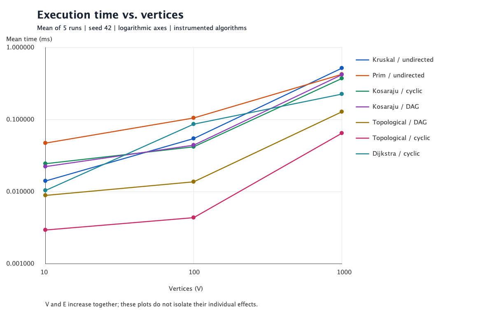
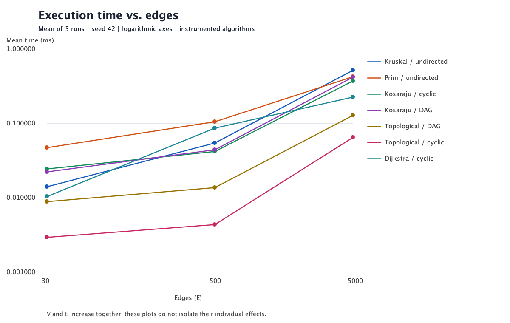

# Assignment 3: Smart City Infrastructure and Route Planning

Simple Java implementations of DSU, minimum spanning trees, directed connectivity,
and shortest paths. No external libraries, Maven, or Gradle are required.

```sh
make test       # Compile and run correctness tests
make run        # Show city planning and route examples
make benchmark  # Recreate CSV tables and PNG plots
make all        # Run everything
```

Requirements: JDK 17 or newer and Make. Open this folder in IntelliJ IDEA, select
a JDK, mark `src` and `tests` as Sources Roots, and run `app.Main`,
`tests.AlgorithmTests`, or `benchmark.Benchmark`. For the benchmark run configuration,
add VM option `-Djava.awt.headless=true` and use the project folder as working directory.
Without Make, compile all Java files under `src` and `tests` into `build`, then run
the same classes with `java -cp build ...`.

## Overview

Vertices are city districts numbered `0..V-1`; weighted edges are roads. For MST,
weights represent construction costs; for Dijkstra, they represent travel distances.
The demo uses separate graphs for these purposes. An MST minimizes the **sum of
construction costs**, while Dijkstra minimizes each route **from one source**.

`Graph` stores an adjacency list and an original edge list. An undirected road is
stored once in the edge list and twice in adjacency lists. Directed roads are stored
once in each. Graph storage is O(V + E). Parallel edges and self-loops are supported;
the benchmark generator produces simple graphs without either.

```text
src/
  graph/          Edge, Graph, Stats
  dsu/            DisjointSetUnion
  mst/            Kruskal, Prim, MstResult
  connectivity/   Kosaraju, TopologicalSort
  shortestpath/   Dijkstra
  app/            Main: runnable city example
  benchmark/      Generator, timing experiment, DSU experiment, plot writer
tests/            Dependency-free correctness tests
results/tables/   Raw runs, statistical summaries, DSU comparison
results/plots/    Execution time vs. V and vs. E
docs/             Russian algorithm walkthrough and grading checklist
```

See [the Russian walkthrough](docs/ALGORITHMS_RU.md) for a step-by-step explanation
and [TASKS.md](TASKS.md) for completed development tasks.

## Implementation

- **DSU:** `parent[]` and `size[]`; iterative `find` compresses the whole visited path.
  `union` attaches the smaller tree below the larger tree and reports whether a merge occurred.
- **Kruskal:** copy and sort original edges, use DSU to reject cycle-forming edges,
  stop after V-1 accepted edges if connected. Input order is preserved.
- **Prim:** grow a tree using `PriorityQueue<Edge>`; discard edges whose destination
  was already visited. Restart at an unvisited district to produce a forest if disconnected.
- **Kosaraju:** iterative DFS collects finishing order; a second DFS on the transpose
  in reverse finishing order collects SCCs. Explicit stacks avoid recursion depth limits.
- **Topological ordering:** Kahn's queue processes zero-indegree vertices. If fewer
  than V vertices are processed, report a cycle and return an empty order.
- **Dijkstra:** a min-heap stores `(vertex, distance)` entries. Ignore stale entries;
  relax an edge only for a strictly shorter distance. Predecessors reconstruct paths.

MST results include chosen edges, `long` total weight, component count, and connectivity.
Disconnected inputs return a minimum spanning **forest**, not a claimed MST. A single
vertex is connected and has weight zero. The empty graph has zero components and is
treated as trivially connected by convention. MST methods reject directed graphs;
SCC and topological ordering reject undirected graphs.

Dijkstra checks **all** edges for negative weights, including unreachable ones.
Unreachable distances are `Long.MAX_VALUE` and paths are empty. Source-to-source path
is `[source]`. `long` arithmetic avoids overflowing an `int` when summing road weights.
Negative weights invalidate the greedy finalization argument: for example, with
`s->a=2`, `s->b=5`, `b->a=-4`, settling `a` at 2 misses the true distance 1.
Use Bellman-Ford for negative weights; this project deliberately rejects them.

Lecture 6 supplies the DSU/MST approach. Its slide 9 line 8 has an apparent typo:
Kruskal must accept an edge when `find(x) != find(y)`, as stated on slide 8.
The assignment additionally requires SCC, topological ordering, and Dijkstra.

## Complexity Analysis

Auxiliary space below excludes the input graph but includes returned results.
`log(E+1)` handles small E. Queues are Java binary heaps with lazy duplicate entries;
they may hold O(E) entries. These bounds match this code, without assuming decrease-key.

| Algorithm | Time | Auxiliary space | Why |
|---|---|---|---|
| DSU initialization | O(V) | O(V) | Two arrays of singleton sets |
| DSU find / union | Amortized O(alpha(V)) per operation | O(1) beyond DSU arrays | Union by size plus full path compression; union calls find twice |
| Kruskal | O(V + E log(E+1) + E alpha(V)) | O(V + E) | Sort a copied edge list, then perform DSU operations |
| Prim, lazy edge heap | O(V + E log(E+1)) | O(V + E) | Scan adjacency and insert/remove up to E candidate edges |
| Kosaraju SCC | O(V + E) | O(V + E) | Two DFS passes and a transposed graph |
| Topological ordering | O(V + E) | O(V) | Count indegrees and process each DAG edge once more |
| Dijkstra, lazy heap | O(V + E + E log(E+1)) | O(V + E) | Validate weights, initialize arrays, scan reachable edges, use heap |
| Reconstruct one path | O(V) worst case | O(V) | Follow predecessor chain and reverse it |

For simple graphs E <= V², heap bounds are commonly written O((V+E) log V),
or O(E log V) for connected MST inputs. More vertices require larger arrays; more
edges increase scans, sorting, and heap work. SCC/topological ordering remain linear.
DSU's amortized bound applies to a sequence of operations; it does not mean every
individual call is constant time. Union by size bounds an individual uncompressed
tree depth by O(log V); an unbalanced DSU without heuristics can have depth O(V).
Reconstructing paths to every vertex can require O(V²) output; benchmarks time
distance computation and predecessor storage, not printing all routes.

## Experimental Setup

| Configuration | V | E |
|---|---:|---:|
| Small | 10 | 30 |
| Medium | 100 | 500 |
| Large | 1000 | 5000 |

Each graph uses `java.util.Random(42)` independently. Weights are integers 1..100.
Undirected generation first connects every new vertex to a random earlier vertex,
then adds random unused pairs until E is reached. This guarantees connectivity.
DAG generation accepts only `from < to`, so directed cycles are impossible. Cyclic
generation first adds `0->1->2->0`, then random unused directed edges; other SCCs
and unreachable vertices may remain. These are controlled generators, not uniform
samples over all connected graphs or all DAGs.

Each of seven algorithm/input combinations is run at all three sizes. Each job has
30 unmeasured warmups followed by **five measured runs on the same graph**. Starting
job order rotates between repetitions. `System.nanoTime()` surrounds the algorithm
call; generation, warmup, output, plotting, and validation are outside that interval.
Sorting, graph transposition, result allocation, and weight validation are included
where the algorithm needs them. A volatile sink retains results. Instrumentation is
enabled equally in measured runs; these are instrumented timings, not pure kernel timings.

The mean is the arithmetic mean of five runs; SD is sample standard deviation
with denominator 4. [raw.csv](results/tables/raw.csv) contains all 105 measured runs.
[summary.csv](results/tables/summary.csv) and [summary.md](results/tables/summary.md)
contain all 21 means, minima, maxima, SDs, and counters. Counters are deterministic
per-run values, not sums over repetitions. Identical-input counter equality is checked.

Recorded environment: Java 25.0.2 HotSpot, macOS 15.6, aarch64, 10 available processors.
Sources compile with `--release 17`. Full metadata and timestamp are in
[environment.txt](results/environment.txt). Rerunning recreates results in place;
graphs and operation counts reproduce, while wall-clock times vary.

## Results

Average execution time in milliseconds from the committed run:

| Algorithm / input | 10 / 30 | 100 / 500 | 1000 / 5000 |
|---|---:|---:|---:|
| Kruskal / undirected | 0.014000 | 0.054059 | 0.514558 |
| Prim / undirected | 0.046992 | 0.104608 | 0.420850 |
| Kosaraju / cyclic | 0.024450 | 0.041758 | 0.369367 |
| Kosaraju / DAG | 0.022025 | 0.043783 | 0.414342 |
| Topological / DAG | 0.008808 | 0.013550 | 0.128242 |
| Topological / cyclic | 0.002925 | 0.004325 | 0.064583 |
| Dijkstra / cyclic | 0.010284 | 0.086083 | 0.223442 |

Operation counts for MST and shortest paths (one measured run):

| Algorithm | V | Edge checks | Sort/heap comparisons | Union / find calls | Heap push / pop | Successful relaxations |
|---|---:|---:|---:|---:|---:|---:|
| Kruskal | 10 | 14 | 107 | 14 / 28 | 0 / 0 | 0 |
| Prim | 10 | 60 | 203 | 0 / 0 | 30 / 30 | 0 |
| Dijkstra | 10 | 60 | 25 | 0 / 0 | 12 / 12 | 11 |
| Kruskal | 100 | 164 | 3827 | 164 / 328 | 0 / 0 | 0 |
| Prim | 100 | 1000 | 7697 | 0 / 0 | 500 / 500 | 0 |
| Dijkstra | 100 | 1000 | 1493 | 0 / 0 | 145 / 145 | 144 |
| Kruskal | 1000 | 3356 | 50369 | 3356 / 6712 | 0 / 0 | 0 |
| Prim | 1000 | 10000 | 110958 | 0 / 0 | 5000 / 5000 | 0 |
| Dijkstra | 1000 | 9946 | 23604 | 0 / 0 | 1419 / 1419 | 1418 |

`edge_checks` counts edge entries examined: Kruskal's sorted candidates; Prim's
adjacency entries (2E); Kosaraju's two passes plus transpose copying (3E);
topological indegree scan plus processed outgoing entries (2E on a DAG);
Dijkstra's E-edge validation plus reachable adjacency scans. `comparisons` counts
only sorting/heap comparator calls, not every Java conditional. `parent_steps`
counts upward parent links during DSU root search, excluding compression writes.
Queue counters cover Prim/Dijkstra heaps and Kahn's queue; Kosaraju uses DFS stacks.
Zero in an inapplicable counter does not imply zero computational work.





Both axes are logarithmic so all sizes remain readable. Lines connect measured
means; they are not fitted complexity curves. Variability is available in the tables.

## Comparison and Discussion

Kruskal was faster on the two smaller inputs; Prim was about 18% faster at V=1000
(0.421 vs. 0.515 ms). Kruskal checked only 3356 candidate edges before reaching V-1
accepted edges, but still sorted all 5000. Prim scanned 10000 adjacency entries and
performed 110958 heap comparisons versus Kruskal's 50369 sort comparisons. A greater
comparison count does not guarantee longer time: the operations, allocation patterns,
and JVM-compiled code differ. These sparse inputs do not establish a universal winner.

Kosaraju's cyclic-input time grew from 0.0418 to 0.3694 ms between medium and large,
about 8.8 times, while V+E grew tenfold. Its counted edge work is exactly 3E:
90, 1500, 15000 on both directed families. This supports linear scaling more directly
than noisy small timings. DAG topological scans are exactly 2E. On cyclic input,
Kahn can stop before processing all vertices: it scans 30, 500, and 5054 edge entries,
including the initial indegree pass. A fast cycle rejection does not produce an order.

Dijkstra performs 60, 1000, and 9946 edge checks and 11, 144, and 1418 successful
relaxations. The large cyclic graph has some vertices unreachable from source 0,
so it scans fewer than 2E entries. Heap comparisons grow to 23604. Timing rises
with graph size, but not proportionally to raw checks because heap occupancy,
reachability, JIT compilation, and fixed overhead also change.

The additional [DSU experiment](results/tables/dsu.csv) uses 1000 vertices, unions
`union(i+1, i)`, and five rounds of querying every vertex. It measures root-search
parent steps per query round, excluding union construction:

| Round | No heuristics | Compression only | Size + compression |
|---|---:|---:|---:|
| 1 | 499500 | 1997 | 999 |
| 2-5, each | 499500 | 999 | 999 |

The naive version forms a chain. Compression flattens it after the first traversal;
union by size prevents that chain in the first place. This intentionally adverse
sequence illustrates the mechanism; it is not an average-case timing claim.

Limitations: five short runs, one seed per family, one JVM process, and 30 warmups
cannot remove all JIT, allocation, GC, or scheduling noise. For example, small Prim
has mean 0.0470 ms, min 0.0075 ms, max 0.1649 ms, and SD 0.0665 ms, so its mean
is strongly affected by one slow run. We keep it in the required arithmetic average.
V and E increase together, so the two plots do not independently measure density
effects. A stronger study would use multiple seeds, process forks, larger inputs,
and a fixed-V density sweep. These measurements illustrate, rather than prove,
asymptotic bounds. In particular, lazy heap Prim need not dominate on dense graphs;
matrix-based O(V²) Prim is another option, outside this implementation.

## Testing

`make test` passes **56,236 always-enabled checks**. No testing framework is required;
failed checks throw `AssertionError` and return a nonzero process exit code.

- Known graphs check exact MST weight 6, shortest distance 6, a reconstructed route,
  a known SCC, unreachable vertices, and a directed cycle.
- Empty graphs, single vertices, disconnected forests, self-loops, parallel edges,
  duplicate weights, multiple valid MSTs, zero weights, and sums above `int` range
  cover boundaries. Negative Dijkstra edges and wrong graph types are rejected.
- Forty fixed seeds compare both MST methods with exhaustive enumeration of
  spanning-tree subsets on 5-vertex graphs, and check edge membership, acyclicity,
  edge count, and reported weight.
- Floyd-Warshall independently checks every source/destination distance on small
  directed graphs. Reconstructed paths must use actual edges and have the expected cost.
- Transitive closure checks that two vertices share an SCC **exactly when** mutually
  reachable. Every vertex must appear exactly once; coverage alone is insufficient.
- DAG orders must contain every vertex once and place every edge forward. Cyclic
  graphs must be rejected. Generator checks cover exact V/E, seed reproducibility,
  valid weights, no duplicate pairs, and MST agreement at every required size.
- DSU tests check merges, repeated unions, component counts, and path compression.

GitHub Actions compiles and tests on Java 17 and 25 and runs the demo. The checked-in
benchmark results are from the local environment above, rather than CI machines.

## Conclusion

Use Kruskal for construction planning with an existing edge list, and Prim when
growing a network through adjacency lists is convenient. Both produce minimum-cost
networks and agree in weight; disconnected inputs require separate infrastructure
components. DSU makes repeated connectivity and cycle checks efficient. Use SCC to
find groups with mutual directed reachability, topological ordering to schedule
acyclic dependencies, and Dijkstra for non-negative single-source travel distances.
The experiments show increasing work with graph size, linear edge scans for directed
connectivity, and the practical benefit of DSU heuristics. Runtime winners depend
on the implementation and input; the operation counts explain the measured trends.

Assignment requirements and Lecture 6 are the supplied course references. See
[the grading map](docs/GRADING.md) for the implementation corresponding to each criterion.
